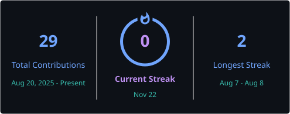

<div align="center">


<br><br>

<a href="https://www.linkedin.com/in/joaopaulodlimaaa"></a>
<a href="https://github.com/joaopaulo-devv"></a>


</div>

**Pentester freelancer** em aplicações web e APIs desde 2025 · **Full Stack** em Node, React e Python · João Pessoa/PB · aberto a oportunidades em **Pentest / AppSec**.

> **Avalie meu trabalho em 2 minutos:** [IDOR e falha de lógica — fase 3](https://github.com/joaopaulo-devv/pentest-ead-writeup/blob/main/03-fase3-idor-bruteforce.md) · [guia de correção priorizado](https://github.com/joaopaulo-devv/pentest-ead-writeup/blob/main/04-guia-de-correcao.md) · [checklist de 10 mitigações no código](https://github.com/joaopaulo-devv/secure-auth-app#checklist-de-segurança-implementado)

<br>

## 👋 Sobre mim

```bash
$ whoami
> João Paulo — João Pessoa/PB
> pentester freelancer (web/APIs) + dev full stack
> café: obrigatório · escopo: sempre autorizado
```

Faço testes de intrusão em aplicações web e APIs desde 2025: análise de vulnerabilidades, prova de conceito e relatório técnico com recomendações de correção. Curso **Análise e Desenvolvimento de Sistemas** na FIAP e tenho formação técnica em Multimídia pelo SENAI.

O trabalho que mais rendeu aprendizado foi um teste **autorizado pelo responsável** de uma plataforma de cursos EAD, em três fases. Encontrei desde falhas de controle de acesso (IDOR) e força bruta de OTP até CORS mal configurado, vídeo pago servido sem autenticação e headers de segurança ausentes.

Minha base de desenvolvedor — banco, API, autenticação, front-end — é o que me deixa explicar *por que* a falha existe, e não só rodar a ferramenta e colar o output.

> **construo pensando em como vou quebrar, e quebro pensando em como corrigir.**

<br>

## 🧭 Como eu trabalho

| Etapa | O que faço | O que entrego |
|:---:|---|---|
| **1. Recon** | mapeio rotas, papéis, fluxos de autenticação e superfície exposta | mapa de ataque |
| **2. Enumeração** | Burp Suite, `curl` e scripts próprios; cada hipótese vira teste | hipóteses priorizadas |
| **3. Exploração** | reproduzo a falha com request/response e meço o impacto real | prova de conceito |
| **4. Correção** | escrevo o relatório por severidade e o guia de remediação para o time | relatório + plano de correção |

<br>

## 🕵️ Áreas de atuação

<table width="100%">
<tr>
<td width="50%" valign="top">

**🔓 Segurança de aplicações**
- IDOR / Broken Access Control
- Autenticação, OTP, sessão e 2FA
- CORS e headers de segurança
- Falhas de lógica de negócio
- Rate limiting / força bruta

</td>
<td width="50%" valign="top">

**🌐 Recon e infraestrutura**
- Enumeração e varredura de portas (Nmap)
- Análise de CDN e conteúdo exposto
- Testes de injeção (SQLi, XSS)
- Superfície de APIs autenticadas

</td>
</tr>
</table>

Metodologia baseada no **OWASP Top 10** e no **OWASP Testing Guide**, com relatórios priorizados por severidade e impacto de negócio — sempre dentro de escopo autorizado.

<br>

## 📌 Projetos em destaque

### 🕵️ [pentest-ead-writeup](https://github.com/joaopaulo-devv/pentest-ead-writeup)

Teste de intrusão **autorizado** (caixa-cinza) em plataforma EAD real, documentado em 3 fases — **10 achados: 1 crítica, 4 altas e 5 médias**, com evidências, prova de conceito e um guia de correção no mesmo formato entregue ao time de desenvolvimento.

| Fase | Escopo | Achados principais |
|:---:|---|---|
| **1** | sem autenticação | CORS mal configurado, enumeração de usuários, rate limiting ausente |
| **2** | conta autenticada | vídeos pagos servidos sem autenticação (CDN), CORS permissivo, sessão concorrente |
| **3** | testes avançados | IDOR em gamificação, força bruta de OTP, headers ausentes, dados expostos no perfil |

→ [Fase 3: IDOR e força bruta](https://github.com/joaopaulo-devv/pentest-ead-writeup/blob/main/03-fase3-idor-bruteforce.md) · [Guia de correção](https://github.com/joaopaulo-devv/pentest-ead-writeup/blob/main/04-guia-de-correcao.md)

<br>

### 🛡️ [secure-auth-app](https://github.com/joaopaulo-devv/secure-auth-app)

App full stack (Node/Express + MySQL + React) com autenticação segura como **requisito de design**, não como reboco depois: bcrypt, JWT em cookie `httpOnly`, `sameSite: strict`, rate limiting, mensagens de erro que não enumeram usuário, queries parametrizadas, CORS por origem explícita, `helmet` e access token de 15 minutos.

São **10 mitigações mapeadas**, cada uma ligada a uma falha real encontrada em auditoria — o lado "construção" do mesmo raciocínio dos pentests.

→ [Checklist de segurança](https://github.com/joaopaulo-devv/secure-auth-app#checklist-de-segurança-implementado)

<br>

## 📂 Outros projetos

| Projeto | O que é | Stack | Código |
|---|---|---|---|
| **Scanner de vulnerabilidades** | CLI que roda verificações em aplicações web e gera relatório em Markdown | Node.js | privado |
| **[FinanceTracker Pro](https://github.com/joaopaulo-devv/finance-tracker-pro)** | dashboard de finanças pessoais com orçamento, metas, recorrência e backup JSON | HTML, CSS, JS | público |
| **[Aleatory](https://github.com/joaopaulo-devv/Aleatory)** | rede social auto-hospedada com canais de texto, mensagens e chamadas de voz | React, Node, Socket.IO, SQLite | público |
| **Balcão Local** | sistema de PDV para pequeno comércio: produtos, vendas, estoque e relatórios | Python, Flask, SQLAlchemy | privado |
| **Nova** | landing page de produto de automação com IA, responsiva e animada | React, Tailwind | privado |

<br>

## 🎓 Formação e certificações

- **Análise e Desenvolvimento de Sistemas** — FIAP (cursando)
- **Técnico em Multimídia** — SENAI
- **Introdução ao Hacking e Pentest 2.0** (8h) — Solyd Offensive Security, 2026

**Em estudo:** OWASP Testing Guide · laboratórios no TryHackMe · segurança de APIs · automação de testes.

<br>

## 🛠️ Ferramentas

**Segurança**

<p align="left">
  
  
  
  
  
  
</p>

**Desenvolvimento**

<p align="left">
  
  
  
  
  
  
</p>

<br>

## 📊 Atividade

<p align="center">
  <picture>
    <source media="(prefers-color-scheme: dark)" srcset="./profile/streak.svg"/>
    <source media="(prefers-color-scheme: light)" srcset="./profile/streak-light.svg"/>
    
  </picture>
</p>

<p align="center">
  <picture>
    <source media="(prefers-color-scheme: dark)" srcset="https://raw.githubusercontent.com/joaopaulo-devv/joaopaulo-devv/output/github-contribution-grid-snake-dark.svg"/>
    <source media="(prefers-color-scheme: light)" srcset="https://raw.githubusercontent.com/joaopaulo-devv/joaopaulo-devv/output/github-contribution-grid-snake.svg"/>
    
  </picture>
</p>

<br>


## 📫 Contato

Aberto a posições em **Pentest / AppSec** — remoto, híbrido ou presencial em João Pessoa/PB. Respondo mais rápido no LinkedIn.

<p align="center">
  <a href="https://www.linkedin.com/in/joaopaulodlimaaa"></a>
  <a href="https://github.com/joaopaulo-devv"></a>
</p>

<p align="center">
  
</p>

<details>
<summary><b>🇺🇸 English</b></summary>

<br>

Freelance pentester for web apps and APIs since 2025, and full-stack developer (Node, React, Python) based in João Pessoa, Brazil. I test authentication, access control and business logic, then write the report and the remediation guide — not just the finding.

**Featured work**

- [Authorized pentest write-up](https://github.com/joaopaulo-devv/pentest-ead-writeup) — EAD platform, 3 phases, 10 findings (1 critical, 4 high, 5 medium), with evidence and a prioritized fix guide.
- [secure-auth-app](https://github.com/joaopaulo-devv/secure-auth-app) — auth built with 10 mitigations by design: bcrypt, httpOnly JWT, strict SameSite, rate limiting, no user enumeration, parameterized queries, explicit CORS, helmet.

**Stack:** Node/Express, React, Python/Flask, MySQL, Burp Suite, Nmap, Linux.

**Open to:** Pentest / AppSec roles, remote or João Pessoa. Reach me on [LinkedIn](https://www.linkedin.com/in/joaopaulodlimaaa).

</details>

<br>


